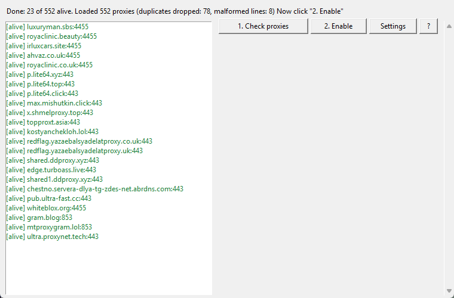

# TG Proxy Checker

**English** | [Русский](README.ru.md)

[](https://github.com/akenra/tgproxy/actions/workflows/tests.yml)
[](https://github.com/akenra/tgproxy/releases)
[](LICENSE)
[](#installation)

Cross-platform GUI app: it downloads fresh public MTProto proxy lists, checks each one with a full handshake (not just "port open", but a real Telegram response) and puts the live ones into the clipboard as a single list to paste into Telegram.



## Table of contents

- [Why](#why)
- [Security](#security)
- [Installation](#installation)
- [Usage](#usage)
- [Custom proxy lists](#custom-proxy-lists)
- [How it works](#how-it-works)
- [Tests](#tests)
- [Build](#build)
- [Contributing](#contributing)
- [Credits](#credits)
- [License](#license)

## Why

Public MTProto proxies are short-lived: a fresh list of 500+ addresses is half dead within a couple of days, and going through it by hand is pointless work. The app checks everything with one button: a full handshake instead of a "ping", hundreds of addresses in parallel, and the output is a ready list of live proxies that Telegram accepts as a whole.

## Security

- Proxies in public lists belong to strangers. The proxy owner sees the connection metadata; do not use such proxies for sensitive traffic.
- The app sends nothing except the check handshake itself: no logins, no telemetry, no requests anywhere else.
- Only two files are created next to the app: the cache of the last check `tgproxy_settings.json` and the error log `tgproxy_error.log` for exceptions.

### Verifying builds

Binaries from release v1.0.5 onward carry a build provenance attestation: a signed record that the file was built from this repository by the release workflow. To verify a downloaded file:

```
gh release download --pattern "tgproxy_gui-windows.exe"
gh attestation verify tgproxy_gui-windows.exe --repo akenra/tgproxy
```

`gh attestation verify` ships with the GitHub CLI and needs nothing else installed.

## Installation

### Prebuilt binaries

Binaries for Windows, macOS and Linux are built automatically and published in [Releases](https://github.com/akenra/tgproxy/releases). Download the file for your OS and run it, no Python needed.

Windows may show a SmartScreen warning (the build is unsigned): "More info" - "Run anyway".

### From source

Python 3.9+ is required:

```
pip install "mtproxy-checker @ git+https://github.com/alimghmi/mtproxychecker.git"
python tgproxy_gui.py
```

## Usage

1. **Check proxies**. If there is no list yet, the app downloads fresh lists (500+ proxies) and checks them right away; previously live proxies from the cache are added to the fresh list and re-checked. If the list is already shown, the button re-checks it without downloading. The cycle usually takes 20-40 seconds.
2. **Enable** copies the live ones to the clipboard as a single list and opens Telegram. Then in Telegram: Settings - Data and Storage - Proxy - Add proxy - paste (Ctrl+V); Telegram parses the whole list at once.
3. Double-clicking a row opens the individual t.me link of that proxy. "?" is help; "Settings" lets you plug in your own list (see below).

The interface supports English and Russian: it follows your system language and can be switched in Settings.

## Custom proxy lists

If the built-in sources are not enough, plug in your own list: the "Settings" button - the "Proxy list URL" field. After saving, click "1. Check proxies".

- An http(s) address of a file with a list is accepted, for example `https://example.com/my_proxies.txt`. While a URL is set, the app uses only it: the built-in sources are skipped. An empty field (or the "All built-in" button) restores the standard sources.
- File format: proxy links separated by newlines or spaces. Each link has the same form as in public lists: `https://t.me/proxy?server=HOST&port=PORT&secret=SECRET`; `tg://proxy?...` with the same parameters is also accepted. Example:

```
https://t.me/proxy?server=proxy.example.com&port=443&secret=00000000000000000000000000000000
tg://proxy?server=1.2.3.4&port=8443&secret=11111111111111111111111111111111
```

- Lines that do not match the format do not break the download: they are skipped, and their number is shown in the final status ("malformed lines: N"). Duplicates are dropped.
- Limits: http(s) only (a local file cannot be plugged in), size up to 5 MB, download timeout 30 seconds.

## How it works

- Checking is two-phase: a fast TCP connect (2.5 s) filters out unreachable addresses; those with an open port go through the full MTProto handshake. 128 threads.
- Only live and unchecked proxies stay in the list: dead ones are hidden, and one that comes back to life reappears on a re-check.
- A single file `tgproxy_gui.py`: stdlib (`tkinter`, `urllib`, `concurrent.futures`) plus a single dependency `mtproxy-checker`. State is the cache of the last check next to the app.

## Tests

Coverage of `tgproxy_gui.py` is at least 95%, a rule baked into `pytest.ini` (`--cov-fail-under=95`); a run below the threshold fails. Actual coverage is 100% (statement and branch).

```
pip install mtproxy-checker pytest pytest-cov
python -m pytest -q
```

## Build

Local single-file build via PyInstaller; build on the target OS, there is no cross-compilation:

Windows:

```
pip install pyinstaller
pyinstaller --onefile --windowed --name tgproxy_gui tgproxy_gui.py
```

Linux/macOS:

```
pip install pyinstaller
pyinstaller --onefile --name tgproxy_gui tgproxy_gui.py
```

The ready binary appears in `dist/`. Release builds are published with a `vX.Y.Z` tag.

## Contributing

Issues and pull requests are welcome. Before a PR, run the tests (`python -m pytest -q`) and format your commits per Conventional Commits: the message format is checked automatically in CI; details and the scope vocabulary are in [AGENTS.md](AGENTS.md). The full contributor guide is in [CONTRIBUTING.md](CONTRIBUTING.md).

## Credits

The proxy check itself is done by [mtproxy-checker](https://github.com/alimghmi/mtproxychecker) (MIT) by [alimghmi](https://github.com/alimghmi): thanks for a clean MTProxy handshake implementation. Prebuilt binaries bundle it together with its dependencies; see [THIRD_PARTY_NOTICES.md](THIRD_PARTY_NOTICES.md) for their licenses.

## License

MIT - see [LICENSE](LICENSE).
