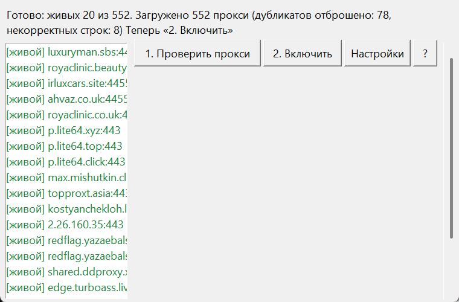

# TG Proxy Checker

**Русский** | [English](README.md)

[](https://github.com/akenra/tgproxy/actions/workflows/tests.yml)
[](https://github.com/akenra/tgproxy/releases)
[](LICENSE)
[](#установка)

Кроссплатформенная GUI-утилита: качает свежие публичные списки MTProto-прокси, проверяет каждый полным хендшейком (не просто «порт открыт», а реальный ответ Telegram) и кладёт живых в буфер обмена одним списком для вставки в Telegram.



## Оглавление

- [Почему](#почему)
- [Безопасность](#безопасность)
- [Установка](#установка)
- [Использование](#использование)
- [Свои списки прокси](#свои-списки-прокси)
- [Как это работает](#как-это-работает)
- [Тесты](#тесты)
- [Сборка](#сборка)
- [Участие в разработке](#участие-в-разработке)
- [Благодарности](#благодарности)
- [Лицензия](#лицензия)

## Почему

Публичные MTProto-прокси живут недолго: свежий список из 500+ адресов через пару дней наполовину мёртв, а перебирать его вручную - бессмысленная работа. Утилита проверяет всё одной кнопкой: полный хендшейк вместо «пинга», сотни адресов параллельно, на выходе - готовый список живых прокси, который Telegram принимает целиком.

## Безопасность

- Прокси в публичных списках - чужие. Владелец прокси видит метаданные соединения; не используйте такие прокси для чувствительного трафика.
- Утилита ничего не отправляет, кроме самого хендшейка проверки и проверки обновлений по нажатию кнопки: без логинов, телеметрии и фоновых обращений.
- Рядом с приложением создаются только два файла: кэш прошлой проверки `tgproxy_settings.json` и лог ошибок `tgproxy_error.log` на случай исключений.

### Проверка сборок

Бинарники начиная с релиза v1.0.5 несут аттестацию провенанса сборки: подписанную запись о том, что файл собран из этого репозитория релизным workflow. Проверить скачанный файл:

```
gh release download --pattern "tgproxy_gui-windows.exe"
gh attestation verify tgproxy_gui-windows.exe --repo akenra/tgproxy
```

`gh attestation verify` входит в GitHub CLI и не требует ничего дополнительно.

## Установка

### Готовые сборки

Бинари для Windows, macOS и Linux собираются автоматически и лежат в разделе [Releases](https://github.com/akenra/tgproxy/releases). Скачайте файл под свою ОС и запустите - Python не нужен.

Windows может показать предупреждение SmartScreen (сборка не подписана): «Подробнее» - «Выполнить в любом случае».

### Из исходников

Нужен Python 3.9+:

```
pip install "mtproxy-checker @ git+https://github.com/alimghmi/mtproxychecker.git"
python tgproxy_gui.py
```

## Использование

1. **Проверить прокси**. Если списка ещё нет, приложение качает свежие списки (500+ прокси) и сразу проверяет; прошлые живые из кэша доливаются к свежему списку и перепроверяются. Если список уже показан, кнопка перепроверяет его без скачивания. Цикл обычно занимает 20-40 секунд.
2. **Включить** копирует живых в буфер одним списком и открывает Telegram. Дальше в Telegram: Настройки - Данные и память - Прокси - Добавить прокси - вставить (Ctrl+V); Telegram распарсит весь список за раз.
3. Двойной клик по строке открывает одиночную t.me-ссылку конкретного прокси. «?» - справка; «Настройки» - подключение своего списка (см. ниже).

Язык интерфейса переключается в настройках: «Авто / Русский / English». В режиме «Авто» язык берётся из системной локали (русская локаль - русский, иная - английский; если локаль не определилась, остаётся русский).

## Свои списки прокси

Если предустановленных источников не хватает, подключите свой список: кнопка «Настройки» - поле «URL списка прокси». После сохранения нажмите «1. Проверить прокси».

- Принимается http(s)-адрес файла со списком, например `https://example.com/my_proxies.txt`. Пока URL задан, программа использует только его: предустановленные источники пропускаются. Пустое поле (или кнопка «Все предустановленные») возвращает стандартные источники.
- Формат файла: прокси-ссылки, разделённые переводами строк или пробелами. Каждая ссылка - того же вида, что в публичных списках: `https://t.me/proxy?server=ХОСТ&port=ПОРТ&secret=СЕКРЕТ`; принимается и `tg://proxy?...` с теми же параметрами. Пример:

```
https://t.me/proxy?server=proxy.example.com&port=443&secret=00000000000000000000000000000000
tg://proxy?server=1.2.3.4&port=8443&secret=11111111111111111111111111111111
```

- Строки не по формату загрузку не ломают: они пропускаются, их число видно в итоговом статусе («некорректных строк: N»). Дубликаты отбрасываются.
- Ограничения: только http(s) (локальный файл подключить нельзя), размер до 5 МБ, таймаут загрузки 30 секунд.

## Как это работает

- Проверка двухфазная: быстрый TCP-коннект (2.5 с) отсекает недоступные адреса, у открывших порт идёт полный MTProto-хендшейк. 128 потоков.
- В списке остаются только живые и непроверенные: мёртвые скрываются, оживший при перепроверке появляется снова.
- Один файл `tgproxy_gui.py`: stdlib (`tkinter`, `urllib`, `concurrent.futures`) плюс единственная зависимость `mtproxy-checker`. Состояние - кэш последней проверки рядом с приложением.

## Тесты

Покрытие `tgproxy_gui.py` не ниже 95% - правило вшито в `pytest.ini` (`--cov-fail-under=95`), прогон ниже порога падает. Фактическое покрытие - 100% (statement и branch).

```
pip install mtproxy-checker pytest pytest-cov
python -m pytest -q
```

## Сборка

Локальная сборка одного файла через PyInstaller; собирать на целевой ОС, кросс-компиляции нет:

Windows:

```
pip install pyinstaller
pyinstaller --onefile --windowed --name tgproxy_gui tgproxy_gui.py
```

Linux/macOS:

```
pip install pyinstaller
pyinstaller --onefile --name tgproxy_gui tgproxy_gui.py
```

Готовый бинарь появляется в `dist/`. Релизные сборки выкладываются тегом `vX.Y.Z`.

## Участие в разработке

Issues и pull request'ы приветствуются. Перед PR прогоните тесты (`python -m pytest -q`) и оформите коммиты по Conventional Commits - формат сообщений автоматически проверяется в CI; подробности и словарь scope - в [AGENTS.md](AGENTS.md). Полное руководство для контрибьюторов - в [CONTRIBUTING.md](CONTRIBUTING.md).

## Благодарности

Саму проверку выполняет [mtproxy-checker](https://github.com/alimghmi/mtproxychecker) (MIT) от [alimghmi](https://github.com/alimghmi): спасибо за аккуратную реализацию MTProxy-хендшейка. Готовые бинари включают её и её зависимости; их лицензии - в [THIRD_PARTY_NOTICES.md](THIRD_PARTY_NOTICES.md).

## Лицензия

MIT - см. [LICENSE](LICENSE).
